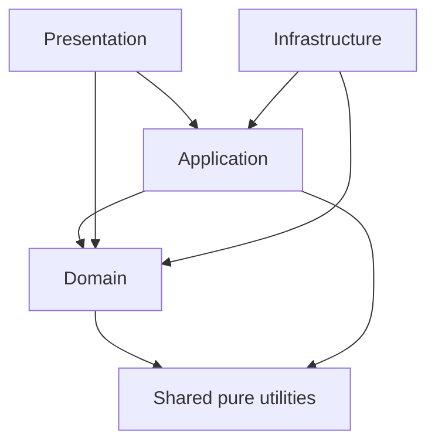

# Architecture

## Dependency direction

Dependencies only point inward. `domain` is pure TypeScript and has no React, Next.js, Zustand, animation, persistence, or network dependency. ESLint encodes these restrictions.

## Rendering decisions

- Accessible controls remain React DOM.
- CSS handles layout, gold-foil surfaces, and lightweight ambient presentation.
- GSAP is dynamically imported by client components only when motion is allowed.
- Three/R3F is isolated behind `LazyAtmosphere`; reduced-motion users receive a static CSS fallback, and the Canvas never owns controls.
- `src/app` is a thin Next.js composition layer; product UI lives in `presentation`.

## Draw experience

- `DrawExperience` in `domain/deck/draw.ts` owns the remaining stable card IDs and enforces `idle → shuffling → ready → drawing → revealed`. The presentation mirrors this state and cannot draw again while an animation is active.
- Fisher–Yates and every probability rule receive an injectable `RandomSource`. Seeded implementations are limited to tests and reproducible demos; they are not cryptographic randomness.
- A `DrawResult` contains the primary `CardInstance`, optional jumper, ISO draw time, and each card's orientation. Removing IDs and deciding both orientations happen atomically in domain code.
- Enhanced devices use dynamically imported GSAP timelines (`presentation/components/draw/drawTimelines.ts`): a two-pass riffle shuffle and a curved flight from the deck to the altar. Low-concurrency devices use CSS keyframes, while `prefers-reduced-motion` skips transitional motion.
- A landed card stays face-down until the person reveals it. Each card tracks its own `sealed → igniting → burning → revealed` presentation state; the domain state is unchanged. Shuffling is disabled until every drawn card is revealed, so a card can never be discarded unseen.
- The burn reveal (`presentation/effects/burn/`) rasterises the exact DOM card-back SVG into a canvas, so nothing visibly swaps when it starts. A pure distance field (`burnField.ts`, unit-tested) is warped by fractal noise and stretched upward, and spreads from the pointer position (keyboard activation ignites the bottom edge). Each frame shades scorch, an incandescent rim and char, then adds embers and a downsampled bloom. All of this happens in canvas, with no CSS filter animated per frame. Reduced motion reveals instantly.
- Decorative glows animate only `opacity` and `transform`. Animating `filter` or `box-shadow` forces a repaint every frame and is avoided.

## Spread table

- `domain/spread` owns the `Spread` and `SpreadPosition` model, numbering, the 1–12 limit, required questions, presets and the versioned snapshot parser. It is framework-free; see [`spread-table.md`](./spread-table.md).
- Persistence goes through the `SpreadSessionStorage` port (`application/ports`). `LocalStorageSpreadSessionStorage` only moves strings; validation and migration live in `application/use-cases/spreadSession.ts`, so no backend can bypass them.
- The table keeps positions in relative coordinates. Zoom and pan are presentation-only view state (`useBoardViewport`), and the draw flight converts its screen path into the landing slot's rotated, zoomed frame.
- `useSpreadDealer` mirrors the draw machine for a spread: one shuffled pile, dealt in number order with `continueDrawing()`, and rebuilt without table cards after a reload or clear.

## Readings

- `domain/reading` builds a versioned `ReadingRequest` from the `Spread` and `DeckRegistry`, decides how each card is read (upright, reversed or neutral) and holds the safety rules. It is framework-free.
- `application/reading/readingSchemas.ts` validates both directions with Zod; `createReadingRequester` adds safe retries by request ID and cancellation. Providers sit behind the `ReadingProvider` port.
- `PrewrittenReadingProvider` composes readings from versioned, lazily loaded content in `infrastructure/reading/content`. See [`reading.md`](./reading.md) and [ADR 0002](./decisions/0002-reading-provider-boundary.md).

## Future extension points

Table scenes, uploaded decks and an AI reading provider will use versioned schemas plus registries or application ports. Infrastructure implementations are injected rather than imported into domain code.
