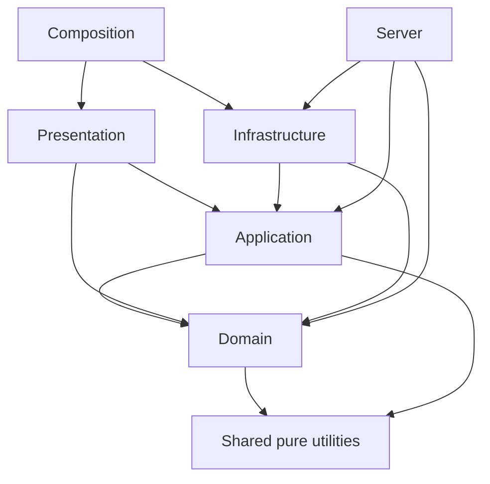

# Architecture

## Dependency direction

Dependencies only point inward. `domain` is pure TypeScript and has no React, Next.js, animation, persistence, or network dependency. `server` composes the reading endpoint for Cloudflare Pages Functions; nothing else may import it, and it may not import presentation. `composition` is the browser's composition root: `createBrowserServices()` picks the concrete adapters (deck registry, `localStorage`, reading provider, share sheet) and `<BrowserServices>` provides them; presentation reads them as ports with `useAtelierServices()` and never imports infrastructure. Tests build their own with `createTestServices()`. ESLint encodes these restrictions.

## Rendering decisions

- Accessible controls remain React DOM.
- CSS handles layout, gold-foil surfaces, and lightweight ambient presentation.
- Motion is CSS keyframes on `transform` and `opacity`, the same on every device; see [ADR 0004](decisions/0004-css-motion-on-every-device.md).
- `src/app` is a thin Next.js routing layer that wraps the page in `<BrowserServices>`; product UI lives in `presentation`.
- Component styles live beside their component (for example `presentation/components/draw/vortex.css`). `src/app/globals.css` imports them in one ordered list, which is the cascade order; components do not import CSS themselves, so development and production builds order rules the same way.

## Draw experience

- `DrawExperience` in `domain/deck/draw.ts` owns the remaining stable card IDs and enforces `idle → shuffling → ready → drawing → revealed`. The presentation mirrors this state and cannot draw again while an animation is active.
- Fisher–Yates and every probability rule receive an injectable `RandomSource`. Seeded implementations are limited to tests and reproducible demos; they are not cryptographic randomness.
- A `DrawResult` contains the primary `CardInstance`, optional jumper, ISO draw time, and each card's orientation. Removing IDs and deciding both orientations happen atomically in domain code.
- Vortex, wheel and flight are CSS keyframes and transitions, the same on every device. `presentation/components/draw/dealMotion.ts` holds their timings, which reach the stylesheet as custom properties, and plans each chosen card's curved flight from the wheel in its slot's frame. `useDealFlights` measures the landing point, writes the flight as custom properties, and only then lets the keyframes start, so a card lands exactly on a moved, rotated position of a zoomed table. `prefers-reduced-motion` skips transitional motion.
- A landed card stays face-down until the person reveals it. Each card tracks its own `sealed → igniting → burning → revealed` presentation state; the domain state is unchanged. Shuffling is disabled until every drawn card is revealed, so a card can never be discarded unseen.
- The burn reveal (`presentation/effects/burn/`) rasterises the exact DOM card-back SVG into a canvas, so nothing visibly swaps when it starts. A pure distance field (`burnField.ts`, unit-tested) is warped by fractal noise and stretched upward, and spreads from the pointer position (keyboard activation ignites the bottom edge). It runs at one canvas pixel per CSS pixel on every screen, because the shading is computed on the CPU. Each frame shades scorch, an incandescent rim and char, then adds embers and a downsampled bloom. All of this happens in canvas, with no CSS filter animated per frame. Reduced motion reveals instantly.
- Decorative glows animate only `opacity` and `transform`. Animating `filter` or `box-shadow` forces a repaint every frame and is avoided.

## Spread table

- `domain/spread` owns the `Spread` and `SpreadPosition` model, numbering, the 1–12 limit, required questions, presets and round identity (`round.ts`). It is framework-free; see [`spread-table.md`](./spread-table.md).
- Persistence goes through `TextStorage` ports (`application/ports`): the template library and the reading history. `LocalStorageTextStorage` only moves strings; validation and migration live in the use cases (`templateLibrary.ts`, `readingHistory.ts`), so no backend can bypass them. The table itself is not stored.
- The table keeps positions in relative coordinates. Zoom and pan are presentation-only view state (`useBoardViewport`), and the draw flight converts its screen path into the landing slot's rotated, zoomed frame.
- `useSpreadDealer` mirrors the draw machine for a spread: hold to lift one pile into the vortex, lay it on the wheel, and draw each chosen card into the next empty position with `drawAt()` and `continueDrawing()`. The pile is rebuilt after the table is cleared.

## Readings

- `domain/reading` builds a versioned `ReadingRequest` from the `Spread` and `DeckRegistry`, decides how each card is read (upright, reversed or neutral) and holds the safety rules. It is framework-free.
- `application/reading/readingSchemas.ts` validates both directions with Zod; `createReadingRequester` adds safe retries by request ID and cancellation. Providers sit behind the `ReadingProvider` port.
- `PrewrittenReadingProvider` composes readings from versioned, lazily loaded content in `infrastructure/reading/content`. See [`reading.md`](./reading.md) and [ADR 0002](./decisions/0002-reading-provider-boundary.md).
- AI readings: the browser's `FallbackReadingProvider` asks `HttpReadingProvider` first and falls back to pre-written readings. The endpoint (`server/readingsEndpoint.ts`) runs `serveReading` with `AiReadingProvider`, `WorkersAiTextGenerator` and `D1UsageLimiter` behind the `TextGenerator` and `UsageLimiter` ports. See [ADR 0003](./decisions/0003-ai-readings-on-pages-functions.md).

## Future extension points

Table scenes and uploaded decks will use versioned schemas plus registries or application ports. Infrastructure implementations are injected rather than imported into domain code.
