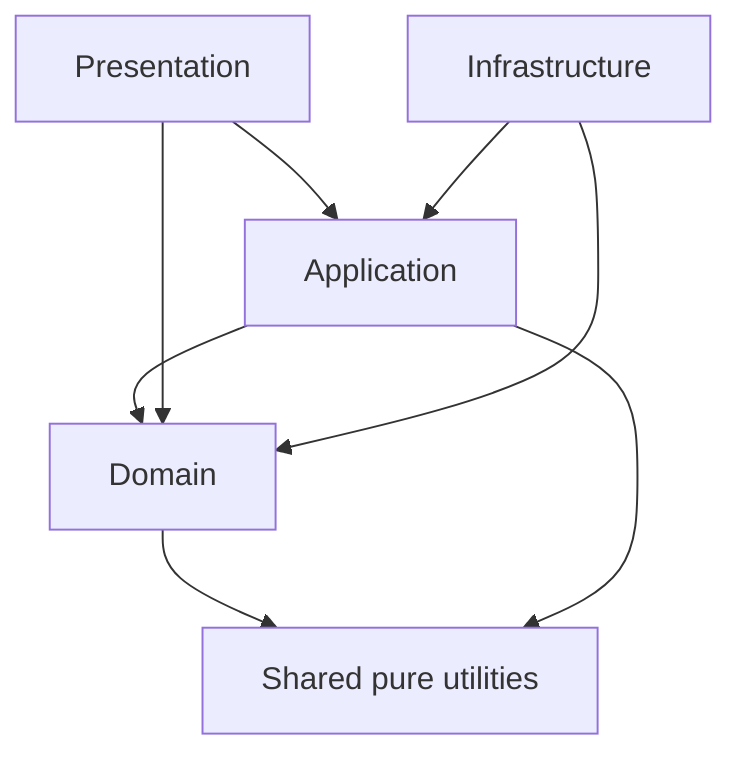

# Architecture

## Dependency direction

Dependencies only point inward. `domain` is pure TypeScript and has no React, Next.js, Zustand, animation, persistence, or network dependency. ESLint encodes these restrictions.

## Rendering decisions

- Accessible controls remain React DOM.
- CSS handles layout, gold-foil surfaces, and lightweight ambient presentation.
- GSAP is dynamically imported by client components only when motion is allowed.
- Three/R3F is isolated behind `LazyAtmosphere`; reduced-motion users receive a static CSS fallback, and the Canvas never owns controls.
- `src/app` is a thin Next.js composition layer; product UI lives in `presentation`.

## Future extension points

Decks, table scenes, persistence, and interpretation providers will use versioned schemas plus registries or application ports. Infrastructure implementations will be injected rather than imported into domain code.
