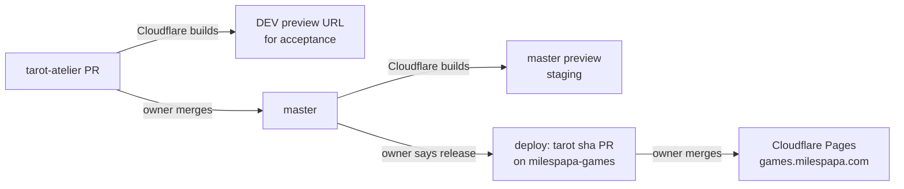

# Deployment

There are two sites:

| Site            | Address                                                                                                             | Updated                                                                                                                                                            |
| --------------- | ------------------------------------------------------------------------------------------------------------------- | ------------------------------------------------------------------------------------------------------------------------------------------------------------------ |
| **DEV preview** | `https://<branch>.<preview-project>.pages.dev/tarot/` for each pull request; the project's own address for `master` | Automatically by Cloudflare Pages on every push to a PR or to `master`                                                                                             |
| **Production**  | https://games.milespapa.com/tarot/                                                                                  | **Only when the owner decides to release**, by merging a `deploy: tarot <sha>` pull request on [`3pwei/milespapa-games`](https://github.com/3pwei/milespapa-games) |



## DEV preview for every pull request

A separate Cloudflare Pages project builds this repository directly, through Cloudflare's own GitHub integration. No token is stored in this repository.

`pnpm preview:build` builds with `NEXT_PUBLIC_BASE_PATH=/tarot` and places the export at `preview/tarot/`, so a preview uses exactly the production paths. The preview root `/` redirects to `/tarot/`, unknown paths get the app's 404 page, and every response carries `X-Robots-Tag: noindex` so previews stay out of search results.

Previews keep their own browser storage: spreads saved on a preview are not visible on production, and the reverse.

### One-time setup (Cloudflare dashboard)

1. Workers & Pages → Create → Pages → **Connect to Git** → authorize the Cloudflare GitHub app for `3pwei/tarot-atelier` only.
2. Project name: for example `tarot-atelier`. Production branch: `master`. Names on `pages.dev` are shared by all Cloudflare users; if the name is taken, Cloudflare appends a random suffix (the current project is served at `tarot-atelier-1va.pages.dev`).
3. Build settings:
   - Framework preset: **None**
   - Build command: `pnpm preview:build`
   - Build output directory: `preview`
   - Root directory: leave empty
4. Environment variables (Production and Preview):
   - `PNPM_VERSION` = `11.25.0` (the build image defaults to pnpm 10, which cannot install this lockfile)
   - Node.js comes from `.nvmrc` (24); set `NODE_VERSION` = `24` only if a build reports another version.
5. Settings → Builds → Branch control: keep **preview deployments for all non-production branches**. The `master` deployment then serves as staging. To skip it, turn off automatic production deployments.

After setup, Cloudflare adds a **Cloudflare Pages** check to each pull request and comments two URLs:

- **Preview URL** (`<commit-hash>.<project>.pages.dev`): that commit only; it never changes.
- **Branch Preview URL** (`<branch>.<project>.pages.dev`): always the newest push. Cloudflare shortens long branch names.

### Acceptance checklist

Run this after creating or changing the preview project. It was last run on 2026-11-07 (PR #14): all passed.

**A. Build** (project → Deployments → latest → View details)

1. The build log shows Node **24.x**, pnpm **11.25.0**, and `Preview ready in preview/ (open /tarot/).`
2. The deployment status is **Success**, and the `master` commit on GitHub shows a passing **Cloudflare Pages** check.

**B. `master` preview (staging)**

| #   | Action                                                         | Passes when                                              |
| --- | -------------------------------------------------------------- | -------------------------------------------------------- |
| 3   | Open the project URL `/`                                       | It redirects to `/tarot/`                                |
| 4   | Look at the page                                               | Header, table and card library render; no missing images |
| 5   | Shuffle → deal → reveal every card                             | The burn reveal works and 「牌陣已完成」 appears         |
| 6   | Open `/tarot/abc`                                              | The app's own 404 page, not a Cloudflare error           |
| 7   | DevTools → Network → reload → first request → Response Headers | `X-Robots-Tag: noindex` is present                       |
| 8   | DevTools → Console                                             | No errors; no failed `_next/` requests                   |
| 9   | Repeat 5 on a phone                                            | Layout fits; dragging and revealing work                 |
| 10  | Save a spread on the preview, then open production             | Production does not show it (storage is separate)        |

**C. Pull request preview**

11. Open a throwaway draft PR that changes one visible label (for example the header chip) and mark it _do not merge_.
12. Within a few minutes the PR shows a passing **Cloudflare Pages** check and Cloudflare's comment with both URLs.
13. The Branch Preview URL shows the new label and passes 3–8.
14. Push a second change to the same PR. The Branch Preview URL shows it; the first commit's Preview URL still shows the first version.

**D. Production untouched**

15. Cloudflare → Workers & Pages → `milespapa-games` → Deployments: no new deployment since the last release.
16. https://games.milespapa.com/tarot/ still shows the released version (its header chip is unchanged).

Close the throwaway PR without merging and delete its branch; branches are auto-deleted only after a merge.

**If the build fails**

| Build log shows                                           | Fix                                                            |
| --------------------------------------------------------- | -------------------------------------------------------------- |
| `ERR_PNPM_UNSUPPORTED_ENGINE` or a lockfile version error | Set `PNPM_VERSION` for both Production and Preview             |
| Node 22.x                                                 | Add `NODE_VERSION` = `24`                                      |
| `preview:build` not found                                 | The build used an older commit; Deployments → Retry deployment |

## Releasing to production

Releases are manual and happen only when the owner decides. From an up-to-date `master`, with a clean checkout of `milespapa-games` next to this repository:

```bash
pnpm release:stage ../milespapa-games
```

It runs the full `pnpm check` with `NEXT_PUBLIC_BASE_PATH=/tarot`, refuses an export built for any other base path, replaces `site/tarot/` entirely so no stale chunks remain, and runs the games site's own `node scripts/check-site.mjs`. It never commits or pushes. Then, in `milespapa-games`:

1. Create a branch `deploy/tarot-<short-sha>` and commit `site/tarot/` as `deploy: tarot <short-sha>`.
2. Open a pull request with the same title, linking the source commit and PR.
3. With preview deployments enabled on the `milespapa-games` project (Cloudflare's default), Cloudflare builds a preview of the deploy branch (`<branch>.milespapa-games.pages.dev/tarot/`). It shows exactly what production will serve, other games included; check it before merging.
4. The owner merges it; Cloudflare Pages publishes `main` to games.milespapa.com.

Next.js generates a new build ID on every build, so every release is a real file diff even if the source did not change.

## Where the tooling lives

`scripts/site/` holds the build and release steps as small TypeScript modules, run directly by Node and unit-tested with Vitest:

| Module            | Responsibility                                                                          |
| ----------------- | --------------------------------------------------------------------------------------- |
| `siteConfig.ts`   | The only place that names the slug (`tarot`), export and preview folders                |
| `staticExport.ts` | Build with the base path; refuse an export built for another one                        |
| `preview.ts`      | Lay out the DEV preview and its Cloudflare host files                                   |
| `gamesSite.ts`    | Stage a release into a `milespapa-games` checkout                                       |
| `process.ts`      | Run commands; injected so tests never spawn real builds                                 |
| `cli.ts`          | The `preview` and `stage` commands behind `pnpm preview:build` and `pnpm release:stage` |

Another Next.js game can reuse the folder by changing `siteConfig.ts` only.

## Rollback

- Production: roll back to the previous deployment in Cloudflare Pages, or revert the deploy merge on `milespapa-games`.
- A bad preview needs no rollback; push a fix to the pull request.
