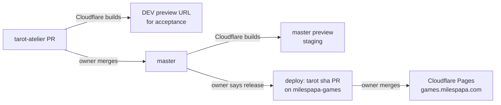

# Deployment

There are two sites:

| Site            | Address                                                                                                             | Updated                                                                                                                                                            |
| --------------- | ------------------------------------------------------------------------------------------------------------------- | ------------------------------------------------------------------------------------------------------------------------------------------------------------------ |
| **DEV preview** | `https://<branch>.<preview-project>.pages.dev/tarot/` for each pull request; the project's own address for `master` | Automatically by Cloudflare Pages on every push to a PR or to `master`                                                                                             |
| **Production**  | https://games.milespapa.com/tarot/                                                                                  | **Only when the owner decides to release**, by merging a `deploy: tarot <sha>` pull request on [`3pwei/milespapa-games`](https://github.com/3pwei/milespapa-games) |



## DEV preview for every pull request

A separate Cloudflare Pages project builds this repository directly, through Cloudflare's own GitHub integration. No token is stored in this repository.

`pnpm preview:build` builds with `NEXT_PUBLIC_BASE_PATH=/tarot` and places the export at `preview/tarot/`, so a preview uses exactly the production paths. The preview root `/` redirects to `/tarot/`, unknown paths get the app's 404 page, and every response carries `X-Robots-Tag: noindex` so previews stay out of search results.

Previews keep their own browser storage: spreads saved on a preview are not visible on production, and the reverse.

### One-time setup (Cloudflare dashboard)

1. Workers & Pages → Create → Pages → **Connect to Git** → authorize the Cloudflare GitHub app for `3pwei/tarot-atelier` only.
2. Project name: for example `tarot-atelier-dev`. Production branch: `master`.
3. Build settings:
   - Framework preset: **None**
   - Build command: `pnpm preview:build`
   - Build output directory: `preview`
   - Root directory: leave empty
4. Environment variables (Production and Preview):
   - `PNPM_VERSION` = `11.25.0` (the build image defaults to pnpm 10, which cannot install this lockfile)
   - Node.js comes from `.nvmrc` (24); set `NODE_VERSION` = `24` only if a build reports another version.
5. Settings → Builds → Branch control: keep **preview deployments for all non-production branches**. The `master` deployment then serves as staging. To skip it, turn off automatic production deployments.

After setup, Cloudflare comments on each pull request with its preview URL. Open it and add `/tarot/` if the link points at the root (the root also redirects).

## Releasing to production

Releases are manual and happen only when the owner decides. From an up-to-date `master`, with a clean checkout of `milespapa-games` next to this repository:

```bash
pnpm release:stage ../milespapa-games
```

It runs the full `pnpm check` with `NEXT_PUBLIC_BASE_PATH=/tarot`, refuses an export built for any other base path, replaces `site/tarot/` entirely so no stale chunks remain, and runs the games site's own `node scripts/check-site.mjs`. It never commits or pushes. Then, in `milespapa-games`:

1. Create a branch `deploy/tarot-<short-sha>` and commit `site/tarot/` as `deploy: tarot <short-sha>`.
2. Open a pull request with the same title, linking the source commit and PR.
3. The owner merges it; Cloudflare Pages publishes `main` to games.milespapa.com.

Next.js generates a new build ID on every build, so every release is a real file diff even if the source did not change.

## Where the tooling lives

`scripts/site/` holds the build and release steps as small TypeScript modules, run directly by Node and unit-tested with Vitest:

| Module            | Responsibility                                                                          |
| ----------------- | --------------------------------------------------------------------------------------- |
| `siteConfig.ts`   | The only place that names the slug (`tarot`), export and preview folders                |
| `staticExport.ts` | Build with the base path; refuse an export built for another one                        |
| `preview.ts`      | Lay out the DEV preview and its Cloudflare host files                                   |
| `gamesSite.ts`    | Stage a release into a `milespapa-games` checkout                                       |
| `process.ts`      | Run commands; injected so tests never spawn real builds                                 |
| `cli.ts`          | The `preview` and `stage` commands behind `pnpm preview:build` and `pnpm release:stage` |

Another Next.js game can reuse the folder by changing `siteConfig.ts` only.

## Rollback

- Production: roll back to the previous deployment in Cloudflare Pages, or revert the deploy merge on `milespapa-games`.
- A bad preview needs no rollback; push a fix to the pull request.
