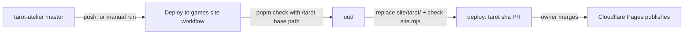

# Deployment

The production site is https://games.milespapa.com/tarot/. It is a static export served by Cloudflare Pages from the `main` branch of [`3pwei/milespapa-games`](https://github.com/3pwei/milespapa-games), which holds the built files of every Milespapa game, one folder each. This repository never publishes directly.

## Flow



The workflow lives at `.github/workflows/deploy-games.yml` and runs:

1. On every push to `master`, except pushes that only touch documentation, Markdown, unit tests or E2E specs. It can also be run by hand from the Actions tab, optionally with a commit, branch or tag.
2. `pnpm check` with `NEXT_PUBLIC_BASE_PATH=/tarot`, so a build that fails lint, tests or the build never reaches the games site.
3. `scripts/stage-games-site.sh` replaces `site/tarot/` entirely and runs the games site's own `node scripts/check-site.mjs`.
4. It pushes `deploy/tarot-<short-sha>` and opens a pull request titled `deploy: tarot <short-sha>`, linking the source commit, source PR and workflow run. Older open `deploy/tarot-*` pull requests are closed as superseded.

Nothing goes live until that pull request is merged. If a deploy PR for the same commit is already open, the run does nothing.

Next.js generates a new build ID on every build, so each run produces a real file diff even when the source has not changed. That is why the push trigger ignores paths that cannot change the site.

## One-time setup: `GAMES_DEPLOY_TOKEN`

The workflow needs a token that can push branches and open pull requests on `milespapa-games` only.

1. GitHub → Settings → Developer settings → Personal access tokens → **Fine-grained tokens** → Generate new token.
2. Resource owner: `3pwei`. Repository access: **Only select repositories** → `3pwei/milespapa-games`.
3. Repository permissions: **Contents: Read and write**, **Pull requests: Read and write**. Leave everything else at No access.
4. Choose an expiry and generate the token.
5. In `3pwei/tarot-atelier` → Settings → Secrets and variables → Actions → **New repository secret**: name `GAMES_DEPLOY_TOKEN`, value the token.

When the token expires, the workflow fails at its first step with a message pointing here; generate a new one and replace the secret.

## Rollback

- Before merging: close the deploy PR.
- After merging: roll back to the previous deployment in Cloudflare Pages, or revert the deploy merge on `milespapa-games`.

## Building by hand

```bash
NEXT_PUBLIC_BASE_PATH=/tarot pnpm check
scripts/stage-games-site.sh out ../milespapa-games
```

The second command only changes the local `milespapa-games` checkout; commit and open the pull request there yourself.
