# Readings

Once every card on the table is revealed, the reading panel can read the spread. Phase 04 ships one provider: **pre-written readings**, composed in the browser from content written ahead of time. It needs no API key, server or network, costs nothing per reading and is labelled 「範例解牌，不是 AI」 wherever it appears.

## Flow

```mermaid
flowchart LR
  S[Spread + DeckRegistry] -->|buildReadingRequest| R[ReadingRequest v1.0.0]
  R -->|readingRequestSchema| Q[createReadingRequester]
  Q -->|ReadingProvider port| P[PrewrittenReadingProvider]
  P -->|composeReading| X[ReadingResult]
  X -->|readingResultSchema + answers the request| U[ReadingPanel]
```

1. **Request** (`domain/reading/buildReadingRequest.ts`): built only from the `Spread` and `DeckRegistry`, never from what the screen shows. Positions are sorted by `index`; a jumper stays inside its position as `jumper` and never adds a position. It refuses missing questions, undrawn positions, unknown or mixed decks and card IDs the deck does not contain, returning those issues instead of throwing.
2. **Boundary** (`application/reading/readingSchemas.ts`): Zod schemas for the request, the result and the request ID. They `satisfies` the domain types, so the two cannot drift. The same schemas are what a future server validates.
3. **Requester** (`application/use-cases/requestReading.ts`):
   - Validates the request before calling the provider, and validates the result after it, including that the result answers the request position by position.
   - Retrying with the same request ID returns the same reading without asking again. Reusing an ID for a different request is refused. Failed and cancelled attempts are forgotten, so a retry runs again.
   - Cancellation uses `AbortSignal`.
4. **Provider** (`application/ports/readingProvider.ts`): `interpret(request, { signal })`. It names no vendor and never sees an API key.
5. **Panel** (`presentation/components/reading/`): a pure reducer keeps reading state apart from the spread, so cancelling or failing never touches the cards. A reading becomes _stale_ when the spread changes afterwards.

## Result format

Each position has the primary card's **symbolism** and an **interpretation**, plus the jumper's **added message** when there is one. The spread as a whole gets a **synthesis**, up to three **reflection questions** and up to three **suggestions** (worded as 「可以考慮…」, never as orders). `sensitiveTopics` flags health, legal and financial questions, and the panel then points to a qualified professional.

Each interpretation is one paragraph of up to three sentences:

1. **What the card means.** Major arcana use their written explanation; minor arcana use their first angle.
2. **What it means in this position.** `domain/reading/positionRole.ts` reads the position's question as past, present, future, obstacle, advice, self, others or unknown. The sentence names that role (「在『現在的狀態』這個位置…」) with another angle; the position's question is never quoted back.
3. **How it relates to the main question** (「對於『面試結果』…」). This is left out when there is no main question. Future positions add that the direction is possible, not decided.

There is one voice; readings have no tone setting (removed by owner decision, 2026-11-07).

## Pre-written content

The content lives in `infrastructure/reading/content/` as versioned JSON, validated with Zod when loaded:

| File                                                     | Contents                                                                                                                                                                              |
| -------------------------------------------------------- | ------------------------------------------------------------------------------------------------------------------------------------------------------------------------------------- |
| `majors-00-10.zh-Hant.json`, `majors-11-21.zh-Hant.json` | 22 major arcana, upright and reversed: symbolism, a written explanation (`core`), three question angles, a reflection question and a suggestion                                       |
| `minors-*.zh-Hant.json`                                  | 56 minor arcana, upright and reversed: the same content without `core`; the `minorCore` template voices them                                                                          |
| `readingPhrases.zh-Hant.json`                            | The position and main-question sentence for each role, minor-card and jumper templates, synthesis sentences, orientation labels, suit themes and a fallback for decks without content |

- **Deterministic:** `composeReading` is pure. It picks between template variants with a hash of the request, so the same spread always reads the same way.
- **Lazy:** each content file is its own chunk, fetched only when a reading is requested. The first page load is unaffected; the standard deck's content is about 32 KB gzipped in total, across seven chunks.
- **No reversed meaning, no invention:** a reversed card is read _neutrally_ when its deck does not support reversals or defines no reversed meaning (`domain/reading/cardMeaning.ts`). It keeps its core symbolism with a note, instead of using placeholder text or making a meaning up.
- **Other decks:** a deck without its own content is read from its manifest: meanings and keywords through the fallback templates. Giving a deck its own content means adding one loader to `contentLibrary.ts`.
- **Authorship:** written by Claude for this project; the content records `review: "pending-owner-review"` until the owner has reviewed it.

### Rules every text follows

Tests enforce these over all content and over composed readings of every card and orientation in every position role:

- No certainty or commands: `FORBIDDEN_CERTAINTY_PHRASES` in `domain/reading/readingSafety.ts` (for example 「一定會」「注定」「保證」「你必須」).
- Reflection questions end with 「？」; suggestions start with 「可以考慮」.
- Lengths stay within `CONTENT_LIMITS`, so text fits a phone.
- Templates use only the placeholders they are filled with. Inserted values (such as a player's question) are never scanned again.

## Adding an AI provider later

Implement `ReadingProvider` with `source: "ai"`, calling the project's own server endpoint. The server validates with the same schemas, keeps the key, applies per-user and daily limits and runs the same safety checks before answering. The panel and the requester need no change. See [ADR 0002](./decisions/0002-reading-provider-boundary.md).
