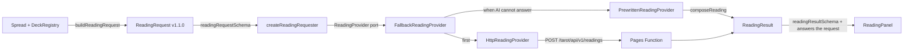

# Readings

Once every card on the table is revealed, the reading panel can read the spread with one button, 「產生解讀」. Published builds read with **AI first** (Phase 05): the site's own endpoint asks Cloudflare Workers AI on its free allocation. When AI cannot answer, the browser falls back to **pre-written readings**, composed in the browser from content written ahead of time (Phase 04), and says why. Pre-written readings are labelled 「範例解牌，不是 AI」 wherever they appear; `next dev` reads with them alone.

## Flow

1. **Request** (`domain/reading/buildReadingRequest.ts`): built only from the `Spread` and `DeckRegistry`, never from what the screen shows. Positions are sorted by `index`; a jumper stays inside its position as `jumper` and never adds a position. It refuses missing questions, undrawn positions, unknown or mixed decks and card IDs the deck does not contain, returning those issues instead of throwing.
2. **Boundary** (`application/reading/readingSchemas.ts`): Zod schemas for the request, the result and the request ID. They `satisfies` the domain types, so the two cannot drift. The same schemas are what a future server validates.
3. **Requester** (`application/use-cases/requestReading.ts`):
   - Validates the request before calling the provider, and validates the result after it, including that the result answers the request position by position.
   - Retrying with the same request ID returns the same reading without asking again. Reusing an ID for a different request is refused. Failed and cancelled attempts are forgotten, so a retry runs again.
   - Cancellation uses `AbortSignal`.
4. **Provider** (`application/ports/readingProvider.ts`): `interpret(request, { signal })`. It names no vendor and never sees an API key.
5. **Panel** (`presentation/components/reading/`): a pure reducer keeps reading state apart from the spread, so cancelling or failing never touches the cards. A reading becomes _stale_ when the spread changes afterwards.

## Result format

Each position has the primary card's **symbolism** and an **interpretation**, plus the jumper's **added message** when there is one. The spread as a whole gets a **synthesis**, up to three **reflection questions** and up to three **suggestions** (worded as 「可以考慮…」, never as orders). `sensitiveTopics` flags health, legal and financial questions, and the panel then points to a qualified professional.

Each interpretation is one paragraph of up to five sentences:

1. **What the card means.** Major arcana use their written explanation; minor arcana use their first angle.
2. **What it means in this position.** `domain/reading/positionRole.ts` reads the position's question as past, present, future, obstacle, advice, self, others or unknown. The sentence names that role (「在『現在的狀態』這個位置…」) with another angle; the position's question is never quoted back.
3. **How it relates to the main question.** Only when there is a main question:
   - **The position's link** (「對於『面試結果』，這可以幫你看清此刻的處境。」), with two wordings per role. Future positions say the direction is possible, not decided.
   - **One more of the card's angles** (「放到這件事上，可以留意的是：…」). Only an angle not used yet and suited to the role; when none fits, the sentence is left out.
   - **A topic line.** `domain/reading/questionTopic.ts` reads the main question as work, love, study, relationships, direction or general, and each topic has one line per role (「以工作或求職來說，可以對照你目前的準備和狀態…」). Questions flagged as health, legal or financial get no topic line; the panel points them to a professional instead.

There is one voice; readings have no tone setting (removed by owner decision, 2026-11-07).

## Pre-written content

The content lives in `infrastructure/reading/content/` as versioned JSON, validated with Zod when loaded:

| File                                                     | Contents                                                                                                                                                                                                                               |
| -------------------------------------------------------- | -------------------------------------------------------------------------------------------------------------------------------------------------------------------------------------------------------------------------------------- |
| `majors-00-10.zh-Hant.json`, `majors-11-21.zh-Hant.json` | 22 major arcana, upright and reversed: symbolism, a written explanation (`core`), three question angles, a reflection question and a suggestion                                                                                        |
| `minors-*.zh-Hant.json`                                  | 56 minor arcana, upright and reversed: the same content without `core`; the `minorCore` template voices them                                                                                                                           |
| `readingPhrases.zh-Hant.json`                            | The position and main-question sentences for each role, topic lines for each topic and role, minor-card, card-link and jumper templates, synthesis sentences, orientation labels, suit themes and a fallback for decks without content |

- **Deterministic:** `composeReading` is pure. It picks between template variants with a hash of the request, so the same spread always reads the same way.
- **Lazy:** each content file is its own chunk, fetched only when a reading is requested. The first page load is unaffected; the standard deck's content is about 34 KB gzipped in total, across seven chunks.
- **No reversed meaning, no invention:** a reversed card is read _neutrally_ when its deck does not support reversals or defines no reversed meaning (`domain/reading/cardMeaning.ts`). It keeps its core symbolism with a note, instead of using placeholder text or making a meaning up.
- **Other decks:** a deck without its own content is read from its manifest: meanings and keywords through the fallback templates. Giving a deck its own content means adding one loader to `contentLibrary.ts`.
- **Authorship:** written by Claude for this project; the content records `review: "pending-owner-review"` until the owner has reviewed it.

### Rules every text follows

Tests enforce these over all content and over composed readings of every card and orientation in every position role and question topic:

- No certainty or commands: `FORBIDDEN_CERTAINTY_PHRASES` in `domain/reading/readingSafety.ts` (for example 「一定會」「注定」「保證」「你必須」).
- Reflection questions end with 「？」; suggestions start with 「可以考慮」.
- Lengths stay within `CONTENT_LIMITS`, so text fits a phone.
- Templates use only the placeholders they are filled with. Inserted values (such as a player's question) are never scanned again.

## AI readings

See [ADR 0003](./decisions/0003-ai-readings-on-pages-functions.md) for the decisions and [`deployment.md`](./deployment.md#ai-readings-one-time-cloudflare-setup) for the setup.

**Endpoint** `POST /tarot/api/v1/readings` (`src/server/readingsEndpoint.ts`), body: a `ReadingRequest`.

| Status        | Body                                             | Browser does                             |
| ------------- | ------------------------------------------------ | ---------------------------------------- |
| 200           | `{ result }` (source `ai`)                       | Shows it, labelled 「AI 解讀」           |
| 429           | `{ reason: "visitor-limit" }` or `"daily-limit"` | Falls back and says the limit is used up |
| 503           | `{ reason: "unavailable" }`                      | Falls back and says AI is unavailable    |
| 400, 403, 413 | `{ error }`                                      | Falls back as unavailable                |

The browser also falls back after 60 seconds without an answer (`READING_WAIT_MS`), or when the endpoint cannot be reached.

Each model call is logged as `reading.ai-call` with its outcome (`answered`, `timeout`, `allocation-used-up` or `failed`), `elapsedMs`, token counts, `finishReason` and `reasoningChars`. Readings ask the model not to think first (`enable_thinking: false`); a `reasoningChars` above 0 means the model ignored that.

**On the server**, `serveReading` does, in order:

1. Validate the request and that its deck and cards exist; refuse it uncounted otherwise.
2. Count it against the visitor's and the site's daily limit (UTC days, when Workers AI's allocation resets).
3. Ask `AiReadingProvider`. It sends the model each card's name, orientation, deck meaning and keywords, and the questions as JSON data. The model returns only the texts: an interpretation per position, a jumper message where there is a jumper, the synthesis, reflection questions and suggestions. Card names and symbolism are filled in from the deck and the pre-written content.
4. Refuse the answer unless it matches the draft schema, answers every position asked and no other, and contains no forbidden certainty phrase.

Workers AI error 4006 (free allocation used up) is reported as `daily-limit`.

**Settings** (Cloudflare Pages, read by `src/server/readingEndpointConfig.ts`):

| Name                        | Kind                   | Default                         |
| --------------------------- | ---------------------- | ------------------------------- |
| `AI`                        | Workers AI binding     | required                        |
| `USAGE_DB`                  | D1 binding             | required                        |
| `VISITOR_SALT`              | secret, 32+ characters | required                        |
| `AI_MODEL`                  | variable               | `@cf/google/gemma-4-26b-a4b-it` |
| `DAILY_AI_READINGS`         | variable               | 150                             |
| `VISITOR_DAILY_AI_READINGS` | variable               | 5                               |
| `AI_TIMEOUT_MS`             | variable               | 45000 (5000 to 55000)           |

Without the bindings or the salt, the endpoint logs which are missing and answers 503, so every reading falls back.
